# Football Player Market Value Prediction

## Web interface

[Open Player Value Prediction](https://MO7KUN.github.io/Football-Player-Market-Value-Prediction/)

The GitHub Pages project link automatically opens the interactive results explorer. Filters and visualizations run in your browser.

**Analyse des performances et de la valeur marchande des joueurs de football**

A complete reproducible study of real Transfermarkt-derived data: collection, preprocessing, exploratory analysis, temporal regression, hyperparameter optimization, player segmentation, uncertainty assessment and reported transfer-fee analysis.

**Executed results:** 14,065 player-season records, 4,815 distinct players, 2018–2025 cutoffs. Selected estimator: **gradient_boosting**. Final 2025 test MAE **€7.65m**, RMSE **€14.54m**, R² **0.474**. These are measured holdout results, not illustrative numbers.

The last-known-value persistence baseline is stronger than the performance-only model on the matched subset. This is a useful negative result: these limited performance statistics do not replace prior market information.

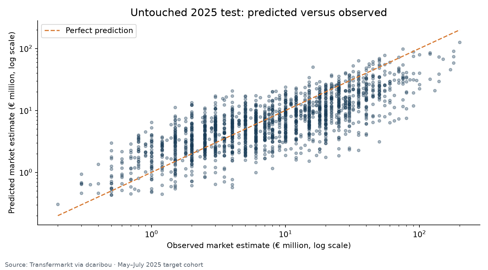

## Contents

1. [Objectives and scope](#objectives-and-scope)
2. [Data and provenance](#data-and-provenance)
3. [Run the project](#run-the-project)
4. [Data schema and preprocessing](#data-schema-and-preprocessing)
5. [Exploratory analysis](#exploratory-analysis)
6. [Regression and optimization](#regression-and-optimization)
7. [Measured results](#measured-results)
8. [Player segmentation](#player-segmentation)
9. [Actual transfer fees](#actual-transfer-fees)
10. [Prediction examples](#prediction-examples)
11. [Limits and interpretation](#limits-and-interpretation)

## Objectives and scope

- Collect player information originating from Transfermarkt, with a published historical snapshot and an optional direct web scraper.
- Study individual performance: appearances, minutes, goals, assists, cards and exposure-adjusted rates.
- Predict the first positive market estimate recorded in the 92-day window beginning 1 May, using only league matches in the preceding 365 days. The May cutoff precedes the main end-of-season valuation updates; choosing a July cutoff would exclude most routinely updated players.
- Discover performance profiles using unsupervised learning, without including prices in the clustering input.
- Examine reported paid transfer fees separately from estimated market values.

The five leagues are Premier League (`GB1`), La Liga (`ES1`), Bundesliga (`L1`), Serie A (`IT1`) and Ligue 1 (`FR1`). Each observation is one player at one annual cutoff. This is a short-horizon summer valuation task, not a long-horizon forecast and not a transfer-fee prediction model.

## Data and provenance

Source: [dcaribou/transfermarkt-datasets](https://github.com/dcaribou/transfermarkt-datasets), derived from [Transfermarkt](https://www.transfermarkt.com/). The upstream dataset is distributed under **CC0-1.0**. See [data licensing](DATA_LICENSE.md) and [source manifest](data/source_manifest.json) for URLs, exact download times, byte counts and SHA256 checksums.

The upstream maintainer reports that updates paused in July 2026. We use historical years ending in 2025; no claim is made that these are October 2026 player values. Observed maximum dates in the downloaded files are **2026-06-28** for appearances and **2026-06-12** for valuations.

| Table | Loaded rows |
| --- | --- |
| players | 50,149 |
| appearances | 1,894,350 |
| valuations | 656,301 |

The primary collection mode downloads published scraped CSV files rather than repeatedly requesting thousands of web pages. `src/scrape.py` also implements direct HTML extraction with BeautifulSoup, a robots.txt check, request spacing, caching, explicit currency parsing and fail-fast handling of blocks or layout changes. See [collection execution notes](reports/collection_notes.md) for the live attempt. The direct scrape is a separate current-data demonstration and is never mixed into historical training features.

Raw files are excluded from Git; the processed research cohort, fitted model artifacts and measured outputs are included. The downloader rejects a checksum change against the committed manifest unless `--refresh` is explicitly requested. Identical reruns depend on the same upstream bytes; if the source changes, obtain the hash-matched snapshot or deliberately regenerate the study.

## Run the project

Python 3.12 is recommended. Run all commands from the repository root.

```bash
python -m venv .venv
# Windows PowerShell: .venv\Scripts\Activate.ps1
# macOS/Linux: source .venv/bin/activate
python -m pip install -r requirements-lock.txt
python -m src.run
python -m pytest -q
```

`requirements-lock.txt` records direct package versions used for this run; transitive dependencies are resolved by pip and are not fully locked. `requirements.txt` offers broader supported ranges. [Environment metadata](reports/environment.json) records the execution environment. A full run downloads roughly 60 MB of compressed data, requires several hundred MB of RAM and trains multiple estimators; duration depends on hardware.

For an intentional data update:

```bash
python -m src.collect --refresh
python -m src.run --skip-download
```

To retrain directly from the committed processed cohort without downloading raw tables:

```bash
python -m src.train
python -m src.predict --input examples/player.csv --output predictions.csv
```

`src.report` additionally needs raw transfer and valuation tables for the fee study. Open [the notebook](notebooks/01_analysis.ipynb) in Jupyter, or [the standalone results explorer](reports/explorer.html) in a browser. The notebook requires Jupyter separately; the core pipeline does not.

Optional single-club scrape (subject to the site's access rules):

```bash
python -m src.scrape "https://www.transfermarkt.com/manchester-city/kader/verein/281"
```

## Data schema and preprocessing

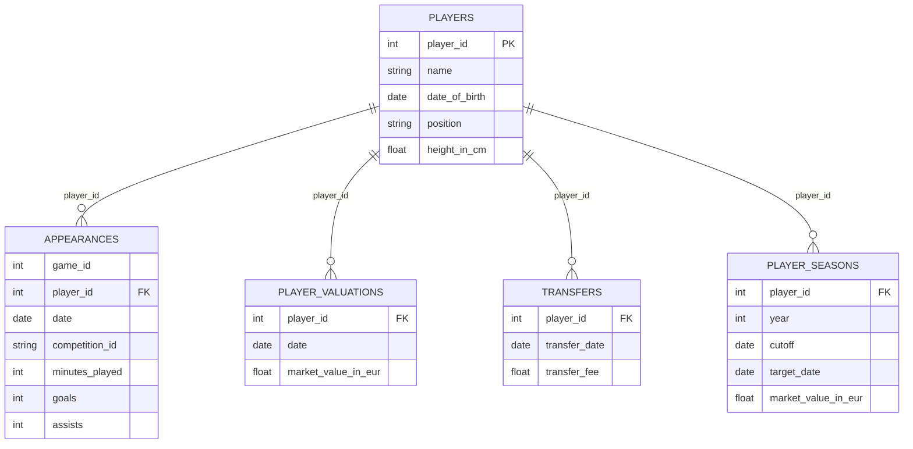

1. Parse all event dates; deduplicate appearances by `(game_id, player_id)` and valuations by `(player_id, date)`.
2. At each 1 May cutoff from 2018 to 2025, retain the preceding 365 days of five-league domestic appearances. Cup, international and other league games are excluded.
3. Require at least **450 minutes** of observed domestic play. A player who changed leagues retains combined five-league totals; league is the most recently observed league.
4. Aggregate appearances, minutes, goals, assists, yellow and red cards. Compute age at the cutoff, minutes per appearance and `count × 90 / minutes` rates. Keep plausible ages 15–45.
5. Select the earliest positive valuation in `[cutoff, cutoff + 92 days)`. Players without this target are omitted, creating a selected coverage cohort rather than a complete census.
6. Retain the last strictly pre-cutoff value only for the persistence benchmark; it is never a regression input.
7. Fit median numeric imputation, categorical mode imputation, standardization and one-hot encoding inside each training fold. Unknown categories are ignored at prediction time. Target values are modelled using `log1p`, then inverted to EUR and clipped at zero for reporting.

**Regression inputs (15):** age, height_in_cm, appearances, minutes_played, goals, assists, yellow_cards, red_cards, goals_per90, assists_per90, yellow_per90, minutes_per_appearance, position, foot, league. Names, player IDs, current club, current value, peak historical value, contract end date, international caps and future events are excluded. [Complete data audit](reports/data_audit.json) includes missingness; [processed data](data/processed/player_seasons.csv) retains event dates for inspection.

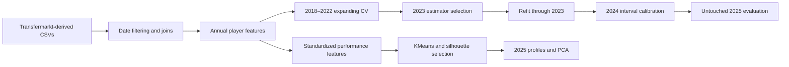

## Exploratory analysis

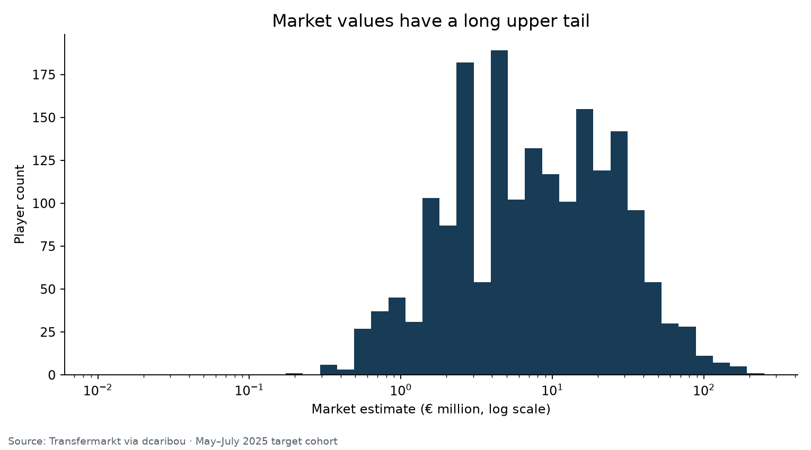
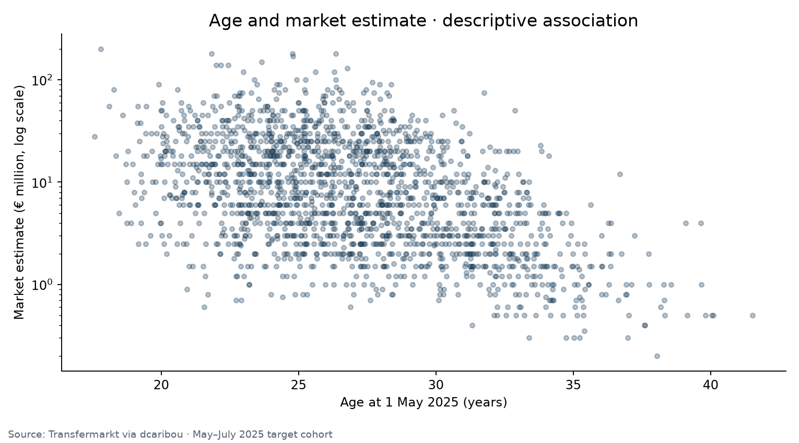
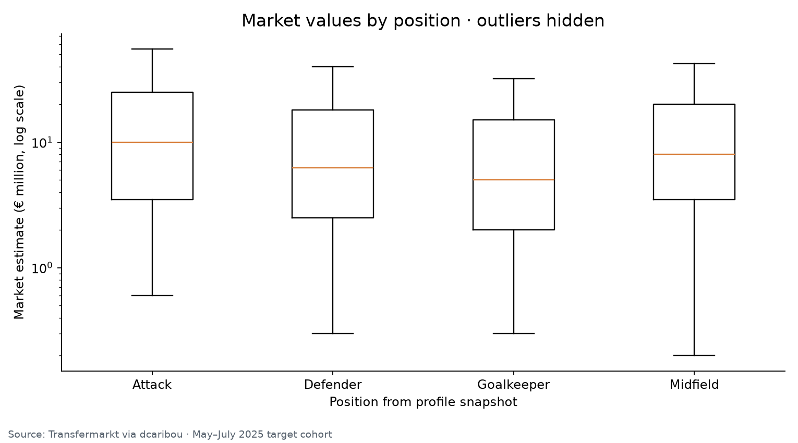
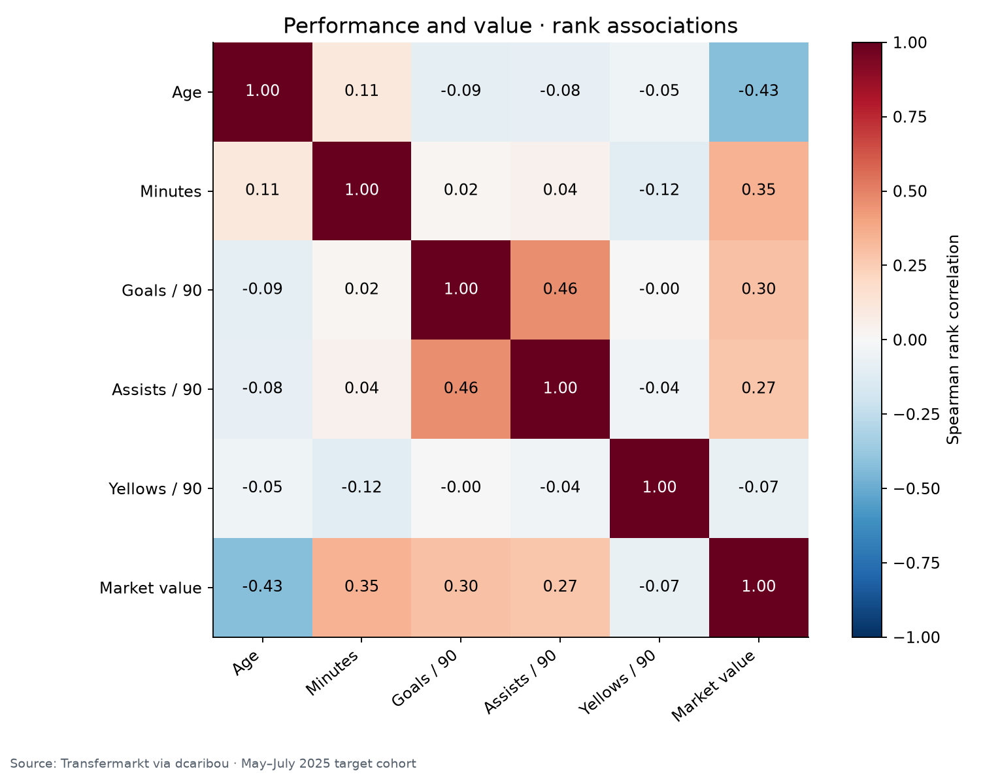

The long upper tail motivates a log-transformed target. Age, playing exposure and attacking output can be associated with value, but these plots do not establish that changing one indicator causes a price change. Per-90 rates reduce differences in playing exposure; the minimum-minutes threshold limits some small-sample instability. The cohort's range and missingness are reported rather than filled before splitting. The 2020 cohort is much smaller because the pandemic disrupted match and valuation calendars; annual counts are available in the data audit. This makes the earliest validation fold less representative.

## Regression and optimization

Three estimator families are compared: regularized linear regression (Ridge), Random Forest and histogram gradient boosting. There are **11 hyperparameter combinations**, each evaluated on **three expanding temporal folds**: 2018–2019 → 2020, 2018–2020 → 2021 and 2018–2021 → 2022. Search scoring is negative MAE in original EUR, even though fitting uses the log target. Forests use 160 trees; boosting uses 180 iterations with internal random early stopping disabled.

| Model | 2023 MAE (€m) | Temporal CV MAE (€m) | Best parameters |
| --- | --- | --- | --- |
| ridge | 7.133 | 7.518 | {"regressor__model__alpha": 10} |
| random_forest | 7.089 | 7.843 | {"regressor__model__max_depth": null, "regressor__model__min_samples_leaf": 3} |
| gradient_boosting | 6.788 | 7.622 | {"regressor__model__l2_regularization": 10, "regressor__model__max_leaf_nodes": 15} |

The best candidate from each family is evaluated on 2023. The family with the smallest 2023 EUR MAE is selected, then refitted on 2018–2023. Neither calibration labels nor test labels select the estimator. Full fold scores are available in `reports/search_*.csv`.

| Role | Years | Rows |
| --- | --- | --- |
| Hyperparameter training | 2018–2022 | 8223 |
| Model selection | 2023 | 1965 |
| Interval calibration | 2024 | 2012 |
| Final test | 2025 | 1865 |

Recurring players may occur in multiple years. This reflects forecasting later values for a population containing incumbents, not an independent-player random split. The unseen-player test subset is also reported. Names and IDs are never estimator features.

## Measured results

| Model / cohort | N | MAE (€m) | RMSE (€m) | R² | Median APE |
| --- | --- | --- | --- | --- | --- |
| selected | 1865 | 7.645 | 14.542 | 0.474 | 48.6% |
| median_baseline | 1865 | 11.727 | 21.956 | -0.200 | 72.7% |
| persistence | 1865 | 1.780 | 3.523 | 0.969 | 12.5% |
| selected_on_persistence_subset | 1865 | 7.645 | 14.542 | 0.474 | 48.6% |
| unseen_players | 629 | 5.826 | 9.818 | 0.616 | 50.2% |

`selected_on_persistence_subset` and `persistence` use the exact same rows. The median baseline uses the training-through-2023 median. RMSE emphasizes expensive-player errors; R² compares squared error against test-mean variation; median APE is the median absolute percentage error and is computed only on strictly positive targets. Log MAE is also preserved in [metrics JSON](reports/metrics.json).

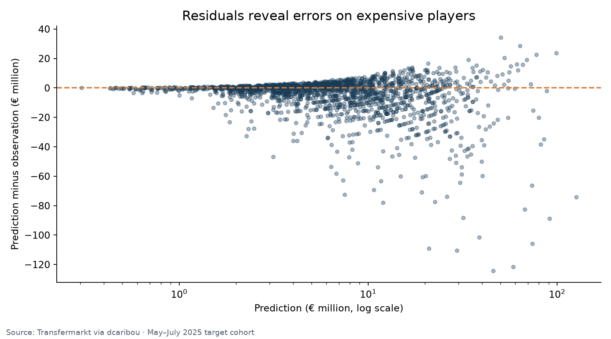
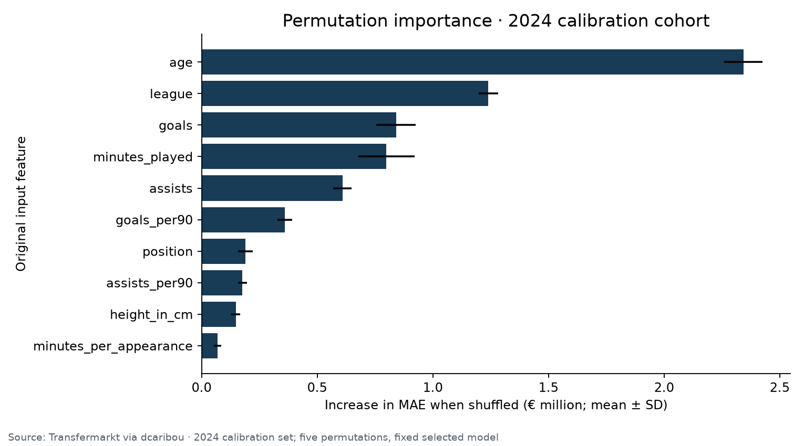

The largest measured permutation effects are **age, league, goals**. Importance is measured on 2024 by shuffling each original feature five times and reporting the increase in EUR MAE. Correlated inputs share information, so these scores are not causal effects or reliable evidence that a low-ranked variable is irrelevant.

Absolute log-residuals on 2024 calibrate a nominal 90% split-conformal-style interval. Empirical coverage on 2025 is **88.5%**, with median width **€20.12m**. Temporal drift and repeated players violate simple exchangeability assumptions; the nominal level is not a guaranteed future coverage rate. The model is not retrained on calibration data after interval construction.

## Player segmentation

KMeans uses standardized **minutes_played, goals_per90, assists_per90, yellow_per90, minutes_per_appearance** only. We select `k` from 2–6 by the largest silhouette score on up to 3,000 sampled training player-seasons, with 20 initializations and seed 42. The fitted historical transformation and centroids assign profiles to 2025 players. **Selected k = 3**.

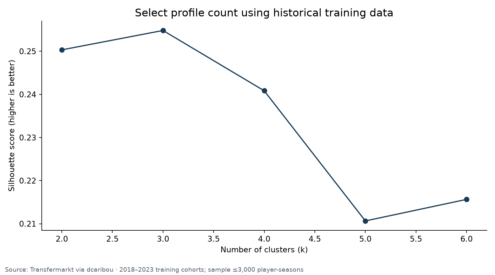
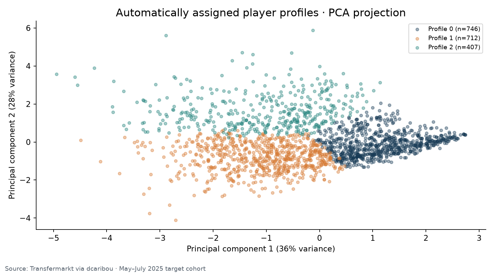
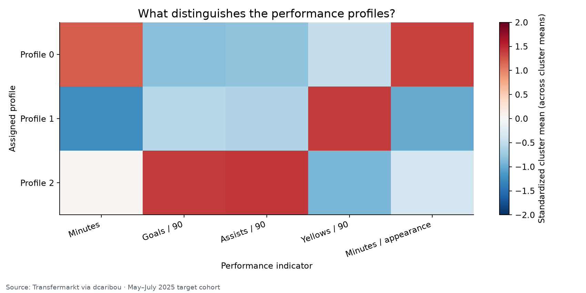

- **Profile 0**: 746 test players; 2283 minutes, 0.05 goals/90, 0.05 assists/90, 0.16 yellows/90 and 81.1 minutes/appearance on average.
- **Profile 1**: 712 test players; 1063 minutes, 0.09 goals/90, 0.07 assists/90, 0.25 yellows/90 and 53.1 minutes/appearance on average.
- **Profile 2**: 407 test players; 1700 minutes, 0.35 goals/90, 0.25 assists/90, 0.14 yellows/90 and 60.6 minutes/appearance on average.

The selected silhouette is modest (about 0.25), indicating overlapping rather than sharply separated profiles. These numeric labels are arbitrary descriptive groups, not scouting grades. Price and age means in the [cluster summary](reports/cluster_summary.csv) describe the assigned groups after fitting and do not drive clustering. PCA is a 2D display only; clustering is performed in the full five-dimensional standardized feature space. Identical player-seasons across years contribute separately, so frequent incumbents have more influence. Defensive ability and goalkeeper quality cannot be identified well from these limited metrics.

## Actual transfer fees

The separate fee study matches **337 paid transactions** from July–September 2025 to the five-league 2025 feature cohort and the last positive valuation **strictly before each transaction**. Free moves, missing fees and nonpositive reported fees are excluded. Players may have multiple distinct transactions. Median fee is **€9.10m**; median fee/pre-transfer-value ratio is **1.00**.

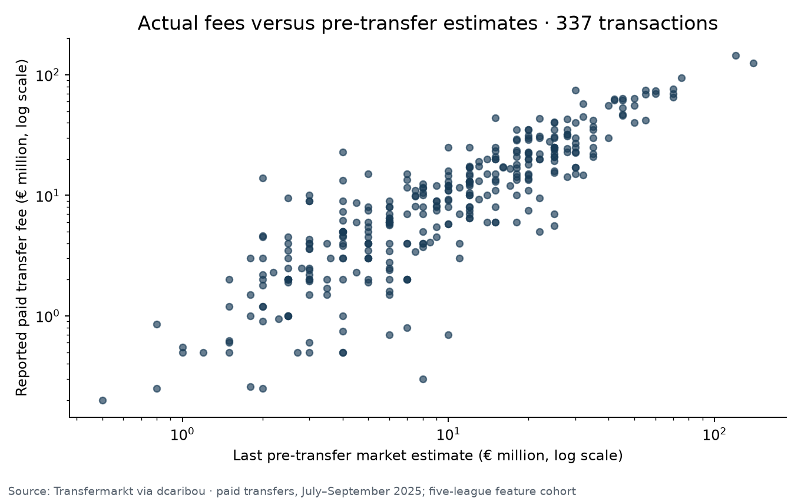

| Indicator | Spearman correlation with fee |
| --- | --- |
| market_value_in_eur | 0.877 |
| minutes_played | 0.304 |
| goals_per90 | 0.259 |
| assists_per90 | 0.228 |
| age | -0.418 |

These are associations for disclosed positive-fee transactions, not a causal price equation. Negotiating power, contract length, loan structure, bonuses, injury history, wages and club finances are not controlled. Reported fees can be incomplete. A Transfermarkt market estimate is not the same variable as a realized transfer fee; the regression above predicts only the former. See [transaction rows](reports/transfer_analysis.csv) and [fee metrics](reports/transfer_results.json).

## Prediction examples

The following are actual held-out 2025 observations. They illustrate model errors and interval width, not today's market prices.

| name | position | market_value_in_eur | prediction_eur | lower90_eur | upper90_eur | cluster |
| --- | --- | --- | --- | --- | --- | --- |
| Jonas Hofmann | Midfield | €2.00m | €1.35m | €0.39m | €4.63m | 2 |
| Daley Blind | Defender | €1.50m | €1.04m | €0.30m | €3.56m | 0 |
| Ashley Young | Defender | €0.50m | €1.67m | €0.49m | €5.72m | 1 |
| Raúl Albiol | Defender | €1.00m | €0.48m | €0.14m | €1.64m | 1 |
| Dante | Defender | €0.50m | €0.43m | €0.12m | €1.47m | 0 |

```bash
python -m src.train
python -m src.predict --input examples/player.csv --output predictions.csv
```

The example CSV contains one real held-out player's prepared features. To predict another player, supply all 15 named columns with the same units and 365-day league-only aggregation. Numeric nulls are imputed; missing column names are rejected. Derived per-90 rates must be internally consistent. Outputs include `prediction_eur`, `lower90_eur`, `upper90_eur` and `cluster`. Fitted model artifacts are included for the recorded package versions and can be recreated locally by training; only load trusted joblib files.

## Repository map

```text
src/collect.py        Published snapshot downloader and checksums
src/scrape.py         Optional cached HTML squad scraper
src/features.py       Dated cohort construction and data audit
src/train.py          Temporal model search, intervals and clustering
src/predict.py        Batch valuation and profile inference
src/report.py         Figures, README, notebook and HTML explorer
src/run.py            End-to-end entry point
data/processed/      Reusable annual research cohort
data/source_manifest.json  Source URLs, dates and hashes
reports/              Measured results, predictions, fee study and figures
notebooks/            Exploratory analysis notebook
examples/             Real prepared input and generated prediction
tests/                Date, leakage, parser and metric checks
.github/workflows/    Automated tests on push and pull request
```

## Limits and interpretation

- **Point-in-time limitation:** position, foot and height come from the downloaded player profile snapshot, not archived annual profiles. Position changes and corrected metadata can introduce look-ahead bias. Match events, ages and valuation labels are dated, but the whole dataset should not be described as perfectly point-in-time.
- **Coverage bias:** only players with enough minutes and a recorded summer value enter the cohort. Absent players are not assigned zero value. Results do not generalize automatically to lower leagues, women's football, academy players or low-minute substitutes.
- **Prediction horizon:** the target may occur from the cutoff to 91 days later; per-row target dates are retained. Near-cutoff valuations may be almost unchanged, which explains why persistence can be strong.
- **Missing quality signals:** no xG, xA, tackles, saves, passing progression, injury or wage data. Goals and assists alone are incomplete performance measures, especially outside attacking positions.
- **Uncertainty:** a single temporal test period and global residual intervals do not establish stable performance across seasons, positions, leagues or price levels. No causal conclusions are claimed.
- **Performance versus price:** this project studies relationships between observed metrics and market estimates; it does not estimate causal determinants of on-field ability. The actual-fee section provides a separate observational analysis.
- **Operational suitability:** the persistence comparison must be considered before deployment. The research estimator demonstrates the full data-science workflow and should not be used as an authoritative transfer valuation.
- **Reproducibility:** seeds are fixed at 42 and direct package versions are recorded. Changes in upstream data, dependencies or numerical libraries can change results. Raw snapshot hashes make such changes visible.

## Verification

Run `python -m pytest -q`. Tests cover cutoff boundaries, earliest summer target selection, separation of previous values from model inputs, currency units, parser failure on block pages, known metric values and integrity of the committed processed cohort. GitHub Actions runs the same tests. The committed [execution record](reports/verification.json) contains local verification outcomes; a local pass does not assert that remote CI has passed.

## License and references

Project source code: [MIT](LICENSE). Data: upstream [CC0-1.0](https://github.com/dcaribou/transfermarkt-datasets/blob/master/LICENSE), with attribution and snapshot details in [DATA_LICENSE.md](DATA_LICENSE.md). No affiliation with Transfermarkt or Sofascore is implied.

- [Upstream dataset and update status](https://github.com/dcaribou/transfermarkt-datasets)
- [Upstream web scraper](https://github.com/dcaribou/transfermarkt-scraper)
- [scikit-learn model selection](https://scikit-learn.org/stable/modules/grid_search.html)
- [scikit-learn clustering](https://scikit-learn.org/stable/modules/clustering.html)
- [scikit-learn permutation importance](https://scikit-learn.org/stable/modules/permutation_importance.html)
